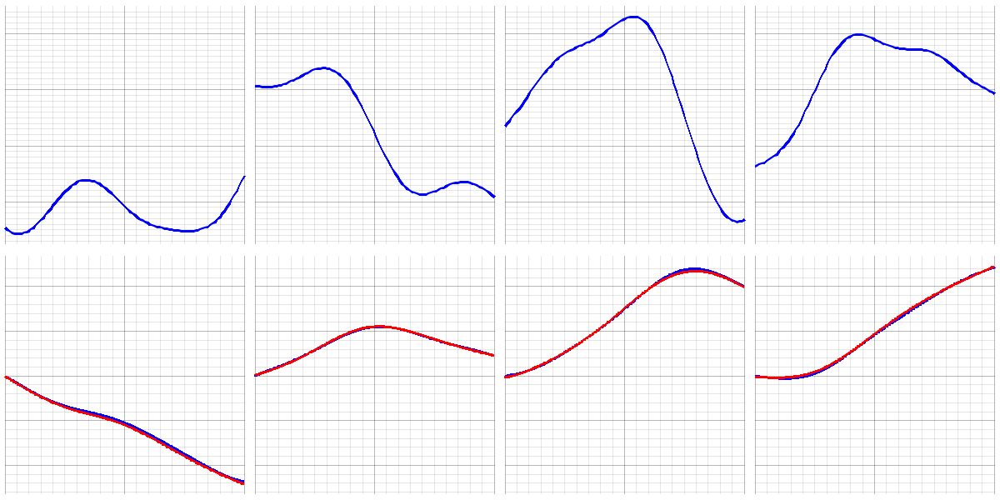

# DeepONet: the antiderivative operator

This tutorial is about a neural operator: a network that maps a whole
*function* to another function, not a finite vector to a finite vector. The
smallest interesting case is the antiderivative operator

$$
G(u)(y) = \int_0^y u(s)\,ds, \qquad y \in [0,1],
$$

following Lu, Jin, Pang, Zhang and Karniadakis, *Learning nonlinear operators
via DeepONet based on the universal approximation theorem of operators*,
Nature Machine Intelligence **3**, 218 (2021).

The sample builds the input functions from a Gaussian random field, trains a
DeepONet on 1000 of them, and reports the relative $L^2$ error on 200 held-out
functions. Everything is generated at startup from a seed; there are no data
files.

## Model

A DeepONet has two subnetworks:

- the **branch** reads the input function at $m = 100$ fixed sensor points and
  returns a $p$-wide vector $b(u) \in \mathbb{R}^p$;
- the **trunk** reads one query point $y$ and returns $t(y) \in
  \mathbb{R}^p$.

Their inner product plus a scalar bias is the prediction:

$$
G_\theta(u)(y) = \sum_{k=1}^{p} b_k(u)\,t_k(y) + b_0,
\qquad p = 40.
$$

Both networks are MLPs with two hidden layers of width 40 and `tanh`
activations: the branch is `[100, 40, 40, 40]` and the trunk is
`[1, 40, 40, 40]`. The final layer has no activation, so the two 40-wide
outputs are contracted by one `dot_general` over $k$. The bias $b_0$ is a
learned parameter like any other.

The optimized parameters are one ordered set:

```
branch weights and biases, trunk weights and biases, b0
```

The same order is used for the initial values and for the compiled program's
inputs. `b0` is the last entry; its initial value is zero.

## Data

Each function is a sample of a zero-mean Gaussian random field with the RBF
covariance

$$
K(s,t) = \exp\!\left(-\frac{(s-t)^2}{2\ell^2}\right),
\qquad \ell = 0.2.
$$

The field is sampled on a 397-point uniform *fine grid* on $[0,1]$. The host
sampler factorizes the covariance matrix by **Cholesky**,
$K + 10^{-10} I = L L^\top$, using `LinalgOps::cholesky` from
`tenferro-linalg` 0.12.0 on a `CpuEngine`, then draws $u = L z$ with standard
normal $z$. The $10^{-10}$ diagonal jitter is needed because the smooth RBF
covariance is numerically singular in `f64`; it is far below the unit kernel
variance, so it does not change the distribution in any visible way. The
factor is computed once and reused for every function. This is a host
computation, not a graph operation: the data is fixed before training.

The branch network sees every fourth fine-grid value, i.e. the 100 sensor
points $y_i = i/99$. The target is the cumulative trapezoid rule of the same
fine-grid samples:

$$
g_0 = 0, \qquad
g_j = g_{j-1} + \frac{h}{2}\left(u_{j-1} + u_j\right),
\qquad h = \frac{1}{396}.
$$

So the sensors and the targets are two views of one discretization, and the
training pairs are all 397 query points of every sampled function.

### Train/test split and seeds

The split is fixed by construction. One master seed `S` (default 42) gives
four independent `StdRng` streams:

| stream | seed | purpose |
| --- | --- | --- |
| training functions | `S` | 1000 functions |
| test functions | `S + 1` | 200 held-out functions |
| initialization | `S + 2` | branch/trunk/`b0` initial values |
| minibatches | `S + 3` | function indices of every epoch |

The training and test sets are drawn from different streams, so they are
disjoint, and the test set does not depend on the training count. The program
prints all four seeds and the split sizes. With the committed `Cargo.lock`, a
given `--seed` reproduces the printed loss and relative-$L^2$ error exactly;
different seeds draw a different training set, initialization and test set.

## Training

The loss is the mean squared error over the $64 \times 397$ batch:

$$
\mathcal{L}(\theta) = \frac{1}{64 \cdot 397}
\sum_{i=1}^{64}\sum_{j=1}^{397}
\left(G_\theta(u_i)(y_j) - G(u_i)(y_j)\right)^2 .
$$

Each epoch samples 64 training functions, evaluates the loss and all
parameter gradients with one `value_and_grad` reverse pass, and updates the
parameters with Adam from `sciml-kit` (learning rate $10^{-3}$). The loss and
the gradients are compiled into **one** program with `GraphCompiler::compile_many`
and prepared once with `Runtime::prepare`; every epoch reuses the prepared
program. A separate forward-only program evaluates the 200 test functions
after training.

tenferro 0.11 has no entry point that accepts an explicit input order for
several outputs at once (tenferro-rs#2642), so the example relies on the
documented order: parameters are created first, then the data placeholders,
and the AD seed constants created by `value_and_grad` come last and are
bound. This is the same convention the other SciML examples follow.

## Run the sample

From the repository root:

```bash
cargo run --release -p deeponet
```

Options:

- `--epochs N` — number of epochs (default 10000).
- `--seed K` — master seed (default 42).
- `--plot FILE` — write the test-function figure.

For a short run:

```bash
cargo run --release -p deeponet -- --epochs 100 --plot deeponet.png
```

CI runs the 100-epoch command on every pull request.

## Results

The default run on one CPU worker (`CpuEngine::serial`) takes about **9.2 s**
total: 0.1 s to generate the data, under 1 ms to compile the fused training
program, and 9.1 s for 10 000 epochs. Peak resident memory is about 50 MB.

| quantity | value |
| --- | --- |
| final training loss (10 000 epochs) | `1.463823e-4` |
| **test relative $L^2$ error** (200 held-out functions) | **`4.672291e-2`** |
| short run (100 epochs) test relative $L^2$ | `2.693487e-1` |

The figure shows four held-out functions. The top row is the input $u$ at the
100 sensors (blue). The bottom row compares the true antiderivative (blue)
with the prediction (red); the two curves nearly overlap. The plot draws grid
lines but no text, because the `plotters` build has no font backend; the axes
are $y \in [0,1]$ and each row is scaled to its own data range.



## Code layout

| file | contents |
| --- | --- |
| `src/main.rs` | seeds, training loop, evaluation, flags |
| `src/model.rs` | the two MLPs, the contraction, `b0`, the ordered parameter set |
| `src/data.rs` | RBF covariance, host Cholesky sampler, trapezoid targets, batching |
| `src/plot.rs` | the test-function figure |

## tenferro notes

The example uses only public 0.12.0 APIs. Two surfaces are worth naming:

- **Host Cholesky.** `LinalgOps::cholesky` on a host `Tensor` is the
  public 0.12 path for the GRF factorization; the traced
  `TracedLinalgOps` would put the same operation in the graph, but the
  data is generated once before training and is not part of the loss.
- **No explicit multi-output input order.** `compile_many` consumes the trace
  input order, and `CompiledGraph::input_keys`/`input_key_index` are
  `#[doc(hidden)]` (tenferro-rs#2642). The example therefore builds the
  placeholders in the order it binds them, as the umbrella conventions
  prescribe.
