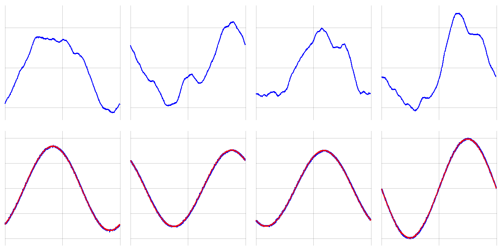

# Fourier neural operator for periodic Burgers

A four-layer [Fourier neural operator (Li et al., ICLR 2021)](https://arxiv.org/abs/2010.08895)
learns the map `u(x, 0) → u(x, 1)` for

```text
u_t + (u²/2)_x = 0.1 u_xx,   x ∈ [0, 1),   u(x + 1, t) = u(x, t).
```

The example generates its reference data at startup with `tenferro-fft`, trains
with traced autodiff and complex spectral parameters, and evaluates the same
weights at 128, 256 and 512 spatial points. Everything uses the released
workspace dependencies; no downloaded dataset or Python environment is needed.

## Reproduce the experiment

From the repository root:

```bash
cargo run --locked --release -p fno_burgers -- \
  --plot examples/fno-burgers/results/prediction.png
```

Defaults: seed 42, 256 training functions, 64 disjoint held-out functions,
width 16, 16 retained Fourier modes (including DC), minibatch size 16, and
1000 Adam steps at training resolution 128. `--epochs` counts minibatch steps,
with sampling with replacement. Adam starts at `1e-3`, halves the learning rate
after half the steps and halves it again after three quarters. `--seed`,
`--width`, `--batch`, `--train-samples`, `--test-samples` and `--plot` override
the other settings; `--help` lists them. Counts and width must be positive.

Training, held-out data, initialization and minibatches use independent
`StdRng` streams with seeds `seed`, `seed + 1`, `seed + 2`, `seed + 3`
(wrapping `u64` addition). Only the training data determines the input and
target RMS normalization. Final errors are recomputed **after the last update**
in physical units, using the global relative L2 norm
`sqrt(sum((prediction - reference)²) / sum(reference²))` over all functions and
grid points. The printed minibatch loss is the target-normalized MSE **before**
that step's update, so it is a different statistic.

### Measured results

Measured on 2026-11-19 with the defaults above, macOS 27.0.1, Apple M3 Pro,
Rust 1.96.0, released tenferro 0.12.0 and `CpuEngine::serial()`:

The committed [run log](results/default-run.txt) records executable source commit
`55dde3b`, the lockfile hash, host/toolchain settings, complete training output,
and the reference-check residuals below.

| Dataset | Grid | Functions | Final relative L2 |
| --- | ---: | ---: | ---: |
| Training | 128 | 256 | `1.03677761e-2` |
| Held out | 128 | 64 | `2.05344239e-2` |
| Held out | 256 | 64 | `2.05434839e-2` |
| Held out | 512 | 64 | `2.05442724e-2` |

Input/target training RMS were `0.569998258` / `0.00925960546`.
The 1000-step run's final pre-update minibatch MSE was `9.63911693e-5`.
The recorded run took 4.179 seconds for data generation and 7.594 seconds for
training (11.881 seconds total, excluding the Cargo build). These are one-run
wall times, not a performance benchmark. The accuracy is from this seeded
small-data experiment, rather than the paper's training protocol.



Each column is one of the first four held-out functions on the 512-point grid.
The top row is the initial condition in blue. The bottom row overlays the
reference at `t=1` (blue, thicker) with the prediction (red). Horizontal axes
cover `[0,1)`; each row shares vertical bounds across columns. There is no font
backend dependency, so labels and the colour key are supplied here. Viscosity
strongly damps these zero-mean fields; the bottom row has a much smaller
amplitude than the top row.

### CI smoke run

```bash
mkdir -p outputs
cargo run --locked --release -p fno_burgers -- --epochs 5 --width 4 \
  --train-samples 8 --test-samples 4 --batch 4 \
  --plot outputs/fno-burgers.png
```

This is the command in the shared `checks.yml` workflow, used by both the
released-dependency and upstream-main lanes. It exercises data generation,
reverse-mode FFTs, both optimizer dtypes, all evaluation resolutions and PNG
output. Five steps demonstrate execution; they do not establish trained accuracy.

## Reference data

`data.rs` samples the zero-mean periodic Gaussian field with covariance
`625 (-∂xx + 25 I)^(-2)` on 1024 points. Equivalently, the cosine and sine
coefficients at frequency `m > 0` are independent normals with standard
deviation `sqrt(2) * 25 / ((2πm)² + 25)`; DC is zero. The finite reference
retains only `3m < 1024`, matching the quadratic 2/3 dealiasing cutoff.
Box–Muller transforms the seeded uniform random stream into normal coefficients.

The solver follows the Lawson integrating-factor RK4 scheme already used in
[`nonlinear-pinn`](../nonlinear-pinn/src/reference.rs), adapted to this domain,
viscosity and ensemble. Diffusion is integrated exactly, while four dealiased
pseudo-spectral nonlinear evaluations advance each fixed `dt=0.002` step
(500 steps to `t=1`). The initial spectrum is projected before forming the
quadratic product. One `FftExecutor` and serial `CpuEngine` are reused across a
dataset; concrete FFT outputs still allocate. All model resolutions subsample
the **same** 1024-point input/target pairs, including the same held-out
functions. Finer evaluation changes neither weights nor normalizers and runs
no optimizer steps.

The tests compare with the analytic Cole–Hopf solution from
`φ(x,t)=1+0.6 exp(-0.1(2π)²t) cos(2πx)` and `u=-2ν ∂x log φ`, verify mean
conservation and reject high-frequency aliasing. For the smooth test at
`t=0.2`, maximum errors at `dt=0.004/0.002/0.001` are
`3.30e-9 / 2.14e-10 / 1.36e-11`. On one seed-42 Gaussian field at 1024 points,
halving the default timestep changes the `t=1` target by `1.73e-8` in relative
L2. These are numerical reference checks, not a learning-accuracy estimate or
an ensemble-wide error bound. Regression limits are `1e-9` for the `t=0.2`
Cole–Hopf check at the default timestep and `1e-7` for the Gaussian residual, leaving modest
roundoff headroom over the recorded values.

## Model, FFTs and complex AD

`model.rs` reuses `sciml-kit`'s real `Mlp` for the linear lift, pointwise skips
and projection `[width, 2*width, 1]`. Each Fourier layer applies

```text
rfft(x, axis=0) → slice 0..16 → dot_general with C64 [16, width, width]
→ transpose to [mode, batch, channel] → pad to n/2+1 → irfft(n)
→ add pointwise Linear(x) → GELU.
```

Spatial points lead the column-major `[n, batch, channel]` tensors. In tenferro
0.12, `dot_general` places its free axes before its batch axes, hence the
explicit transpose. The real FFT already returns complex values, so this
spectral contraction needs no mixed real/complex conversion. Real weights use
the shared Xavier initializer; each complex weight's real and imaginary parts
are independent uniforms in `±sqrt(1.5/width)`, giving `E|w|²=1/width`.

The original [issue #11](https://github.com/tensor4all/tenferro-examples/issues/11)
suggested C2C FFTs while real-FFT AD was missing. The later maintainer comment
permits native real FFTs once the fixes land. Released 0.12 contains
[real-FFT AD #2646](https://github.com/tensor4all/tenferro-rs/pull/2646),
the [slice-extent fix #2647](https://github.com/tensor4all/tenferro-rs/issues/2647)
and the [padded-chain fix #2648](https://github.com/tensor4all/tenferro-rs/issues/2648).
The released concrete `irfft(n=8)` still rejects a three-bin spectrum with
`expected 5 for output length 8, got 3`; setting `n` does not supply the missing
one-sided bins. This is why the model explicitly pads to `n/2+1` first.
The example tests the complete native truncation/explicit-padding chain on the
released crates. FFT rules must be registered in `AdContext`, and the CPU FFT
module must be installed in `Runtime`. The default traced `value_and_grad`
does not register FFT rules in this release, so `main.rs` uses one
`AdContext::vjp_many` with scalar seed 1, then compiles the loss and all gradients
together. It prepares once and reuses that program through training; each
evaluation shape gets a forward-only program.

Complex cotangents use the documented
[`Re(conj(g) * dz)` convention](https://github.com/tensor4all/tenferro-rs/blob/v0.12.0/docs/guides/complex-ad.md).
For a real loss, `g.re = ∂L/∂Re(w)` and `g.im = ∂L/∂Im(w)`, so descent uses
`w -= lr*g` without another conjugation. The spectral regression perturbs every
real and imaginary weight coordinate by `1e-4` on even and odd grids with two
channels and two samples, comparing central differences to AD within `1e-8`.
It includes DC's zero imaginary derivative and a nonzero target to expose phase
and sign mistakes. A separate analytical Fourier test checks channel mixing
and rejection of omitted modes.

All F64 parameters precede all C64 parameters in both placeholder and initial
value order. Two existing `sciml-kit::Adam` instances update those homogeneous
groups on the same schedule; the complex second moment uses `g*conj(g)`.
Parameters are never split into real/imaginary trainable arrays. GPU execution,
paper-scale datasets, and a JAX baseline are outside this example.
