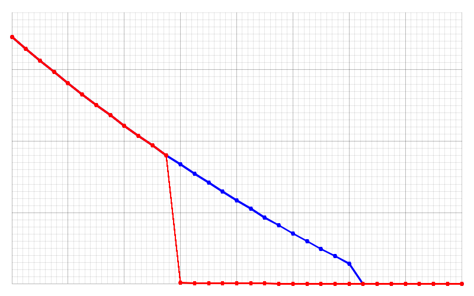

# DMFT with IPT: the Mott transition on the Bethe lattice

This example solves the half-filled Hubbard model on the Bethe lattice
with dynamical mean-field theory (DMFT)
and the iterated perturbation theory (IPT) impurity solver,
following Georges, Kotliar, Krauth and Rozenberg,
[Rev. Mod. Phys. **68**, 13 (1996)](https://doi.org/10.1103/RevModPhys.68.13).
It sweeps the interaction $U$ up from the metal and down from the insulator
and finds the range where both solutions exist:
the coexistence region of the first-order Mott transition.

```bash
cargo run --release -p ipt_dmft -- --plot ipt-dmft.png
```

## Model and loop

The lattice has a semicircular density of states with half-bandwidth $D = 2t$,
the unit of energy ($D = 1$).
On the Bethe lattice the DMFT self-consistency closes in one line,
so each iteration on the fermionic Matsubara frequencies
$\omega_n = (2n + 1)\pi/\beta$ is

1. the Weiss field $\mathcal{G}_0(\mathrm{i}\omega_n) = 1/(\mathrm{i}\omega_n - t^2 G(\mathrm{i}\omega_n))$,
2. its Fourier transform $\mathcal{G}_0(\mathrm{i}\omega_n) \to \mathcal{G}_0(\tau)$,
3. the second-order self-energy $\Sigma(\tau) = U^2 \mathcal{G}_0(\tau)^3$,
4. the transform back $\Sigma(\tau) \to \Sigma(\mathrm{i}\omega_n)$,
5. the new $G(\mathrm{i}\omega_n) = 1/(\mathcal{G}_0^{-1}(\mathrm{i}\omega_n) - \Sigma(\mathrm{i}\omega_n))$,
   mixed half and half with the previous one.

The loop stops when no $G(\mathrm{i}\omega_n)$ changes by more than $10^{-9}$.
The quasiparticle weight is read from the lowest frequency,
$Z = 1/(1 - \operatorname{Im}\Sigma(\mathrm{i}\omega_0)/\omega_0)$.

The metallic sweep starts from the $U = 0$ Green's function
$G(\mathrm{i}\omega_n) = 2(\mathrm{i}\omega_n - \mathrm{i}\,\mathrm{sgn}(\omega_n)\sqrt{\omega_n^2 + D^2})/D^2$,
the insulating sweep from the atomic limit
$G(\mathrm{i}\omega_n) = \mathrm{i}\omega_n/((\mathrm{i}\omega_n)^2 - U^2/4)$.
Each later $U$ starts from the solution at the previous one.

## The Fourier transforms

A Matsubara function is kept on the $M$ positive frequencies
(`--n-matsubara`, default 2048);
the negative ones follow from $F(-\mathrm{i}\omega_n) = F(\mathrm{i}\omega_n)^*$.
Imaginary time has $N = 2M$ points $\tau_k = k\beta/N$, $\Delta\tau = \beta/N$.
Writing the phase of the transform with $n$ running over the $N$ frequencies
$n = -M, \dots, M - 1$,

$$
\begin{aligned}
\omega_n \tau_k
&= \frac{(2n + 1)\pi}{\beta} \cdot \frac{k\beta}{N} && (1.1) \\
&= \frac{2\pi nk}{N} + \frac{\pi k}{N}, && (1.2)
\end{aligned}
$$

so both directions are one length-$N$ FFT and an element-wise phase:

- $\mathrm{i}\omega_n \to \tau$:
  $F(\tau_k) = \frac{1}{\beta}\mathrm{e}^{-\mathrm{i}\pi k/N} \sum_n \mathrm{e}^{-2\pi\mathrm{i}nk/N} \left(F(\mathrm{i}\omega_n) - \frac{1}{\mathrm{i}\omega_n}\right) - \frac{1}{2}$,
  a forward `fft`.
  The $1/(\mathrm{i}\omega_n)$ tail is subtracted before the sum and added back as its exact transform, $-1/2$.
- $\tau \to \mathrm{i}\omega_n$:
  $F(\mathrm{i}\omega_n) = \Delta\tau \sum_k \mathrm{e}^{2\pi\mathrm{i}nk/N} \left(\mathrm{e}^{\mathrm{i}\pi k/N} F(\tau_k)\right)$,
  an unnormalized inverse `ifft` (`FftNorm::Forward`): the trapezoidal rule.

At half filling $F(\tau) = F(\beta - \tau)$ and $F(\mathrm{i}\omega_n)$ is purely imaginary,
so the result is projected onto its imaginary part.
That removes the real end-point term of the trapezoidal rule.
The leading Euler-Maclaurin term,
$\mathrm{i}\omega_n \Delta\tau^2 (F(0^+) + F(\beta^-))/12 = \mathrm{i}\omega_n \Delta\tau^2 F(0^+)/6$,
is added, so the error is $O(\Delta\tau^4)$.

All arrays stay `Tensor`s on a `CpuEngine`:
the transforms use one `tenferro_fft::FftExecutor`, which keeps the FFT plans between calls,
and the rest of the loop is element-wise `CoreOps`
(`sub`, `div`, `mul`, `conj`, `reverse`, `concatenate`, `slice`, `scale_real`),
with rank-0 tensors broadcast as constants.

## Result

With the defaults ($\beta D = 100$, $M = 2048$) the run takes under a second;
besides the table of $Z$ it prints

```
U = 0 check: max |G - G_semicircle| = 3.7e-10
coexistence: insulator down to U = 2.600 D, metal up to U = 3.200 D
```

The first line solves $U = 0$ from the atomic-limit start
and compares the converged $G$ with the semicircular Green's function;
the difference is the stopping tolerance of the loop.
The transforms themselves are checked against closed forms in the tests:
$\mathrm{i}\omega_n \to \tau$ to $2 \times 10^{-3}$ (the first neglected tail term)
and $\tau \to \mathrm{i}\omega_n$ to $10^{-6}$.

The coexistence window is where the two sweeps reach different solutions
(their $Z$ differ by more than $10^{-3}$), on a grid of step $0.05\,D$.
Every $U$ is iterated with the mixing $G \leftarrow \frac{1}{2} G_\mathrm{new} + \frac{1}{2} G$
until no $G(\mathrm{i}\omega_n)$ changes by more than $10^{-9}$, with $M = 2048$:

| Source                                                     | $T/D$ |  $U_{c1}/D$ |  $U_{c2}/D$ |
| ---------------------------------------------------------- | ----: | ----------: | ----------: |
| this example, `--beta 40`                                  | 0.025 |        2.60 |        2.85 |
| this example, `--beta 100`                                 |  0.01 |        2.60 |        3.20 |
| this example, `--beta 200`                                 | 0.005 |        2.60 |        3.30 |
| IPT (Georges et al., Sec. VII.D.1)                         |     0 |       ≈ 2.6 |       ≈ 3.3 |
| exact diagonalization and projective method (same section) |     0 | 2.15 ± 0.25 | 2.92 ± 0.05 |

The window widens towards the $T = 0$ IPT values as the temperature drops.
At $T = D/40$ its upper end agrees with $U_{c2} \in [2.85, 2.9]\,D$ of the
[sparse-ir IPT tutorial](https://spm-lab.github.io/sparse-ir-tutorial/src/DMFT_IPT_py.html)
for the same model and temperature.
IPT is second-order perturbation theory in $U$,
which at half filling also reproduces the atomic limit;
in between it is an approximation,
and the last row shows that it places the coexistence window about $0.4\,D$ too high.



The figure has no text, because `plotters` is built without a font backend.
The horizontal axis is $U/D$ from 2 to 3.6, the vertical axis $Z$ from 0 to 1.1 times its largest value.
Blue is the sweep up from the metal, red the sweep down from the insulator;
they differ in the coexistence region.

## Flags

- `--beta B`: inverse temperature in units of $1/D$ (default 100).
- `--n-matsubara M`: number of positive Matsubara frequencies (default 2048).
- `--iterations N`: largest number of iterations per $U$ (default 3000);
  a $Z$ that did not converge is marked with `*`.
- `--plot <path>`: write the figure.

## Code layout

- `src/ipt.rs`: the Matsubara grid, the two transforms, one IPT step and the mixed loop.
- `src/main.rs`: the two sweeps, the printed table and the coexistence window.
- `src/plot.rs`: the figure.

The tests check each transform against a closed form,
that $U = 0$ converges to the semicircular Green's function,
the coexistence at $T = D/40$,
and the coexistence window of two given sweeps.
