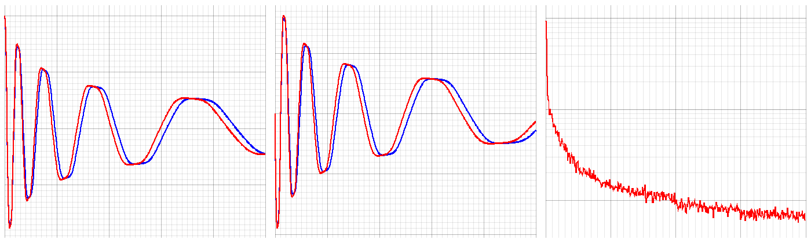

# Neural ODE

This example fits a neural ordinary differential equation (Chen, Rubanova,
Bettencourt and Duvenaud, *Neural Ordinary Differential Equations*, NeurIPS
2018) to a two-dimensional spiral. The unknown is the right-hand side of an
initial value problem; the network never sees the trajectory as a table of
labels, only as the target of a short solver window.

Use this sample after the [Traced autodiff tutorial](https://tensor4all.org/tenferro-rs/tutorials/traced-autodiff-jax-style.html)
when you want a solver inside the traced graph: the state is integrated with
classical Runge-Kutta 4, the loss is differentiated with respect to the network
parameters through the solver, and the gradient of a whole window comes from
one compiled program.

## Problem Being Solved

The dynamics are the cubic spiral

$$
\frac{dz}{dt} = A z^{3}, \qquad
z^{3} = (z_1^3, z_2^3), \qquad
A = \begin{pmatrix} -0.1 & 2.0 \\ -2.0 & -0.1 \end{pmatrix},
\qquad z(0) = (2, 0),
$$

on $t \in [0, 25]$. The cubic term makes the oscillation frequency grow with
the amplitude, so the trajectory spirals: this is the standard test problem of
the neural-ODE literature, small enough to train on a CPU.

The reference trajectory has $N = 1000$ equally spaced samples,
$h = 25 / (N-1) \approx 0.025025$. It is generated once at startup with RK4
and 100 substeps per sample interval.

Training uses random windows of $S = 10$ consecutive samples. Each epoch draws
64 start indices uniformly from $0,\dots,N-S-1$, takes the reference state at
the start as the initial condition $z_0$, and compares the solver's ten states
$z_1,\dots,z_{10}$ with the reference. The loss is the mean absolute error

$$
L = \frac{1}{64 \cdot 2 \cdot 10} \sum_{b=1}^{64} \sum_{k=1}^{10} \sum_{c=1}^{2}
\bigl| z_{k,c}^{(b)} - \hat z_{k,c}^{(b)} \bigr| .
$$

## Model and Solver

The right-hand side is a fully connected network applied to $z^3$,

$$
f_\theta(z) = \mathrm{MLP}_{\theta}(z^3),
$$

with architecture `[2, 50, 2]`: two inputs, one hidden layer with 50 units and
`tanh` activations, two outputs. The layers use Xavier-uniform weights
($\pm\sqrt{6/(\text{fan\_in}+\text{fan\_out})}$) and zero biases, both from
[`sciml-kit`](../../crates/sciml-kit).

One step of the solver is classical RK4 with step size $h$,

$$
z_{k+1} = z_k + \frac{h}{6}(k_1 + 2k_2 + 2k_3 + k_4),
$$

where $k_1 = f_\theta(z_k)$, $k_2 = f_\theta(z_k + \tfrac{h}{2}k_1)$,
$k_3 = f_\theta(z_k + \tfrac{h}{2}k_2)$ and $k_4 = f_\theta(z_k + h k_3)$.
The stepper (`ode::rk4_step`) takes the right-hand side as a closure that
builds traced operations, not as a fixed network, so it can move to a
`tenferro-diffeq` crate later.

## How the Gradient Is Taken

The obvious construction — unroll all ten steps, then call `value_and_grad`
once — does not work with the tenferro 0.11.0 compiler: preparing that graph
reproduces every input shape symbolically and the resulting shape expressions
grow exponentially, so a three-step window exhausts 20 GB of memory. The
measurements are in [`IMPLEMENTATION-PLAN.md`](../../IMPLEMENTATION-PLAN.md)
§7 and in the upstream report (tenferro-rs#2643).

Instead the example uses the **checkpointed discrete adjoint**. One RK4 step is
traced once, with the state and the cotangent as inputs:

$$
\text{step}: \quad z_{\text{next}} = \mathrm{RK4}(f_\theta, z_{\text{prev}}),
\qquad
\text{spot} = \sum_{b,c} \lambda_{b,c} \, (z_{\text{next}})_{b,c}.
$$

`spot.value_and_grad` over the four parameter tensors and $z_{\text{prev}}$
emits six outputs: $z_{\text{next}}$, the four parameter gradients and the
cotangent of $z_{\text{prev}}$. `compile_many` puts them in one program and
`prepare` runs once, before the first epoch.

An epoch is then ten forward runs of that program, collecting the checkpoints
$z_1,\dots,z_{10}$, followed by ten reverse runs. The reverse pass starts with
$\lambda = 0$, adds the mean-absolute-error cotangent
$\operatorname{sign}(z_k - \hat z_k) / (64 \cdot 2 \cdot 10)$ of the current
checkpoint once, and feeds the previous run's $z_{\text{prev}}$ gradient in as
the next $\lambda$. The parameter gradients accumulate on the host; Adam and
the learning-rate schedule come from [`sciml-kit::optim`](../../crates/sciml-kit/src/optim.rs).
No tracing, compiling or preparing happens inside the epoch loop.

This is the discrete adjoint of the ten-step map — the same gradient the
unrolled graph would give, checked against a finite difference in
`src/train/tests.rs` — computed by checkpointing instead of by one deep graph.

## Results

A full run on an AMD Ryzen AI MAX+ 395 (single-threaded CPU engine):

| quantity | value |
| --- | --- |
| graph build + `compile_many` | 0.001 s |
| first `prepare` | 0.008 s |
| training, 20 000 epochs | 151.3 s (7.57 ms per epoch) |
| runs per epoch | 20 (10 forward, 10 reverse) |

The figure below is the run with `--seed 42`: the trajectory of $z_1$ and $z_2$
on the left (blue reference, red prediction) and the training loss on the
right (block means over 50 epochs, log scale).



```bash
cargo run --release -p neural_ode -- --epochs 20000 --seed 42 --plot neural_ode.png
```

The loss of the last sampled minibatch falls from $1.2 \times 10^{-1}$ at
epoch 0 to $4.0 \times 10^{-4}$; the table below reports that same
last-minibatch loss (a single random batch is noisy), and the figure shows
block means. The pointwise relative $L^2$ error of the whole
25-time-unit trajectory is **31 %** for this seed. The gap
between the two numbers is the honest finding of this example: a model that
predicts every ten-step window to $4 \times 10^{-4}$ can still drift in phase
over a thousand chained steps, because the window loss constrains the field
locally and the eval feeds the model's own state back in.

The result depends strongly on the seed. Over seeds 42–47, with everything
else fixed:

| seed | final window loss | trajectory relative $L^2$ |
| --- | --- | --- |
| 42 | $4.0 \times 10^{-4}$ | 31 % |
| 43 | $2.6 \times 10^{-4}$ | 15 % |
| 44 | $3.2 \times 10^{-4}$ | 46 % |
| 45 | $5.7 \times 10^{-4}$ | **3.8 %** |
| 46 | $3.3 \times 10^{-4}$ | 17 % |
| 47 | $6.6 \times 10^{-4}$ | 15 % |

All six runs reach the same window-loss floor; the long-horizon error spans
3.8 % to 46 %. In other words, the 10-step objective does not select the
frequency of the learned field precisely enough, and which side of that
plateau a run lands on is decided by the initial weights and the window
sequence. More epochs do not fix it: 50 000 epochs with seed 42 end at 31.6 %
with the same loss floor. The default seed is 42, the first seed of this
table; `--seed 45` reproduces the 3.8 % trajectory.

## Code Layout

| file | contents |
| --- | --- |
| `src/main.rs` | flags, reference data, epoch loop, evaluation, plotting |
| `src/data.rs` | reference trajectory, minibatches of windows |
| `src/model.rs` | the `[2, 50, 2]` right-hand side |
| `src/ode.rs` | generic RK4 step and a forward-only rollout |
| `src/train.rs` | the checkpointed step program and the window adjoint |
| `src/plot.rs` | the three-panel figure |

`src/main.rs` also builds the evaluation program: a forward-only rollout of ten
steps, chained on the host a hundred times to cover the trajectory. Its first
`prepare` takes a few milliseconds, because the forward graph does not carry
the reverse-mode shape expressions that block the training graph.

## Options

- `--epochs N` number of epochs (default 20000; the CI short run uses 20).
- `--seed K` master seed (default 42); initial weights use `K`, window draws
  use `K+1`, and the same seed reproduces the printed numbers exactly.
- `--plot <path>` write the trajectory and loss figure as a PNG.

## What to Try Next

The continuous adjoint of Chen et al. is a different algorithm: it integrates
an augmented state backwards through the solver and needs derivatives of the
learned field at the solver's stage points, instead of replaying the discrete
steps. It is a separate change, not part of this example.
