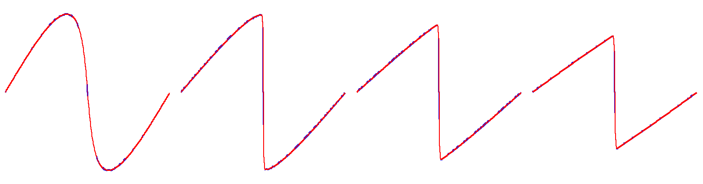
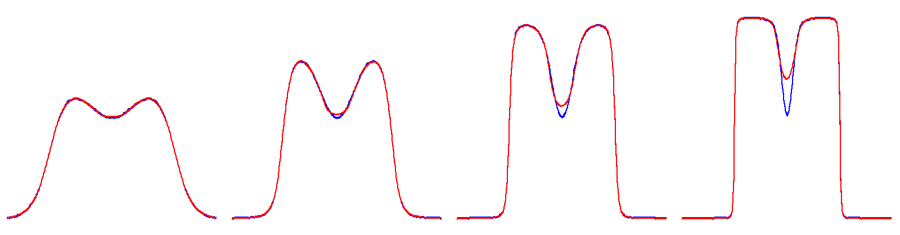

# Nonlinear PINNs: Burgers and Allen-Cahn

Physics-informed neural networks (PINNs) for two nonlinear PDEs, trained with
Adam and with Adam followed by L-BFGS, the standard baseline of the field
([tenferro-examples#9](https://github.com/tensor4all/tenferro-examples/issues/9),
part of the SciML plan in
[#6](https://github.com/tensor4all/tenferro-examples/issues/6)). The third
optimizer of the issue, Levenberg-Marquardt, is not wired up yet
(`--optimizer lm` says so and exits). The step in `pinn-gauss-newton`
([#8](https://github.com/tensor4all/tenferro-examples/issues/8)) is local to
that example, so it has to move to `sciml-kit` first. At this size it is also a
dense $5409 \times 5409$ Cholesky of $J^\top J$ per step, with $J$ of 8384
residuals by 5409 parameters, so it needs its own measurement.

## Problems

**Viscous Burgers** (Raissi, Perdikaris and Karniadakis, J. Comput. Phys.
**378**, 686 (2019)):

$$
u_t + u\,u_x = \frac{0.01}{\pi}\,u_{xx}, \qquad x \in [-1, 1],\ t \in [0, 1],
\qquad u(x, 0) = -\sin(\pi x), \qquad u(\pm 1, t) = 0 .
$$

A steep front forms at $x = 0$ after $t \approx 0.3$.

**Allen-Cahn**:

$$
u_t = 10^{-4}\,u_{xx} - 5u^3 + 5u, \qquad x \in [-1, 1],\ t \in [0, 1],
\qquad u(x, 0) = x^2 \cos(\pi x), \quad \text{periodic in } x .
$$

The reaction term drives $u$ to $\pm 1$ with thin interfaces.

## Model and loss

A tanh MLP with 6 hidden layers of width 32 (`sciml-kit`'s `Mlp`, Xavier
initialization). For Burgers it sees $(x, t)$. For Allen-Cahn it sees
$(\cos \pi x, \sin \pi x, t)$, so every prediction is exactly periodic in $x$
with all its derivatives and the boundary needs no loss term.

The loss is the mean squared PDE residual on 8000 collocation points plus the
mean squared initial-condition misfit on 256 points, and for Burgers the mean
squared boundary value on 128 points ($x = \pm 1$). Allen-Cahn weights the
initial-condition term by 100, as Wang, Sankaran and Perdikaris (2022) do.
The derivatives $u_t$, $u_x$, $u_{xx}$ are nested `jvp`s of the network with
respect to the collocation placeholders. No time-marching, causal weighting or
other Allen-Cahn-specific training scheme is used, for either optimizer.

All training points are drawn once from the seed and stay fixed, so the loss is
a deterministic function of the parameters, which L-BFGS needs.

## Training

One compiled program returns the loss and every parameter gradient
(`value_and_grad` over the ordered parameter set, `compile_many`), prepared once
and run for every Adam step and every line-search trial.

- `adam`: Adam with learning rate $10^{-3}$, halved at half the steps and halved
  again at three quarters (`sciml-kit`'s `step_decay_lr`).
- `adam-lbfgs`: the same Adam schedule for `--adam-steps`, then `--lbfgs-steps`
  iterations of `sciml-kit`'s `Lbfgs`: 50 curvature pairs, two-loop recursion
  and a backtracking Armijo line search on the host over the flat parameter
  vector. Each trial is one run of the compiled program; the gradient of an
  accepted trial is reused, so an iteration usually costs one run.

## Reference solution

`src/reference.rs` solves both PDEs pseudo-spectrally on a periodic grid with
`tenferro-fft` (`rfft`/`irfft` through one `FftExecutor`, so plans are reused):
the diffusion is integrated exactly and the nonlinearity with the Lawson
integrating-factor RK4 scheme, with the top third of the modes zeroed (the 2/3
rule). That dealiases Burgers' quadratic term exactly but Allen-Cahn's cubic
term only partly; a solve with the exact 1/2 rule differs from it by at most
$4 \times 10^{-11}$. Burgers is periodic
through the odd symmetry of its initial data. Burgers uses 4096 points and
Allen-Cahn 2048, both with $\Delta t = 10^{-4}$; the solve takes about a second.

Its accuracy is checked in the unit tests: Burgers against the exact Cole-Hopf
solution (error below $10^{-6}$ at $t = 0.25$ and below $10^{-4}$ on the front
at $t = 0.5$, already at 1024 points), Allen-Cahn by halving the grid spacing
and the step (change below $10^{-3}$).

The error metric is the relative $L^2$ error on 256 equispaced $x$ times 101
times $t = 0, 0.01, \dots, 1$.

## Run the sample

```bash
cargo run --release -p nonlinear_pinn -- --problem burgers --optimizer adam-lbfgs --plot burgers.png
cargo run --release -p nonlinear_pinn -- --problem allen-cahn --optimizer adam --adam-steps 20000
```

| option | default | meaning |
| --- | --- | --- |
| `--problem` | `burgers` | `burgers` or `allen-cahn` |
| `--optimizer` | `adam-lbfgs` | `adam` or `adam-lbfgs` (`lm` not wired up yet) |
| `--adam-steps` | 10000 | Adam steps |
| `--lbfgs-steps` | 10000 | L-BFGS iterations (`adam-lbfgs` only) |
| `--seed` | 42 | initialization and training points |
| `--plot` | none | PNG with reference and prediction at four times |

## Results

Seed 42, one CPU worker per run (`CpuEngine::serial`), 20 000 steps of
training for every run. The JAX column is `jax_baseline.py` with the same
settings (its own random draws for the points and the initialization).

| problem | optimizer | steps | final loss | **relative $L^2$ error** | JAX + Optax error |
| --- | --- | --- | --- | --- | --- |
| Burgers | `adam` | 20 000 Adam | `4.99e-5` | **`1.18e-2`** | `3.98e-3` |
| Burgers | `adam-lbfgs` | 10 000 Adam + 10 000 L-BFGS | `3.53e-7` | **`3.93e-4`** | `2.09e-4` |
| Allen-Cahn | `adam` | 20 000 Adam | `5.67e-3` | **`5.10e-1`** | `5.13e-1` |
| Allen-Cahn | `adam-lbfgs` | 10 000 Adam + 10 000 L-BFGS | `7.91e-6` | **`3.26e-2`** | `2.73e-2` |

L-BFGS used 11 426 (Burgers) and 11 015 (Allen-Cahn) program runs for its
10 000 iterations, so the line search almost always accepts the first trial.
The comparison is the known one: on Burgers, Adam followed by L-BFGS is 30
times more accurate than Adam alone for the same number of steps. On
Allen-Cahn, Adam alone does not learn the interface dynamics at all (its error
is that of a smoothed initial condition), while L-BFGS reaches 3 %. Both
implementations agree on this, to within the spread expected from different
random draws.

The figures show the reference (blue) and the `adam-lbfgs` prediction (red) at
$t = 0.25, 0.5, 0.75, 1$ from left to right, over $x \in [-1, 1]$ and
$u \in [-1.1, 1.1]$ (no axis labels: the `plotters` build has no font
backend). On Burgers the curves overlap, front included; on Allen-Cahn the
remaining error sits in the dip at $x = 0$.





**Cost per step.** Measured alone on one pinned core of an AMD Ryzen 9 9950X, an
Adam step (one run of the compiled loss-and-gradient program plus the host
update) takes 116 ms for Burgers and 91 ms for Allen-Cahn; the JIT-compiled JAX
step takes 36 ms and 31 ms, measured the same way (the difference of a
1300-step and a 300-step run, so compilation is excluded). The full runs above
were four at a time next to the four JAX runs, so their wall times (about
1.7 h each, against 1 h for JAX) are not a clean comparison.

## JAX baseline

`jax_baseline.py` is the same setup in JAX + Optax (not run in CI): same
problems, network, point counts, loss weights, Adam schedule and evaluation
grid, the same spectral reference in NumPy, and `optax.lbfgs` with its default
zoom (strong Wolfe) line search in place of the backtracking search. It is a
self-contained `uv` script:

```bash
XLA_FLAGS="--xla_cpu_multi_thread_eigen=false intra_op_parallelism_threads=1" \
    taskset -c 0 uv run jax_baseline.py --problem burgers --optimizer adam-lbfgs
```

## Code layout

| file | contents |
| --- | --- |
| `src/main.rs` | options, training program, Adam and L-BFGS loops, evaluation |
| `src/problem.rs` | the two PDEs: coefficients, initial data, network input, traced residual |
| `src/reference.rs` | the `tenferro-fft` pseudo-spectral reference |
| `src/plot.rs` | snapshot figure |
| `crates/sciml-kit/src/optim.rs` | `Adam`, and the new `Lbfgs`, `flatten`, `unflatten` |

## tenferro notes

The example uses only public 0.11.0 APIs.

- **`jvp` tangents carry data.** The ones tangent of the derivative `jvp`s is a
  full-shape constant leaf, as in `kdv-pinn`; a rank-0 constant expanded with
  `broadcast_in_dim` is rejected as a tangent in 0.11
  ([tenferro-rs#2642](https://github.com/tensor4all/tenferro-rs/issues/2642)).
- **Input order.** `compile_many` takes the trace order of the inputs, so the
  parameters are created first and the data placeholders in the order they are
  bound (#2642).
- **`Tensor` is not `Clone`.** The L-BFGS trial buffers are rebuilt with
  `Tensor::from_vec_col_major`.
- **Speed.** The training step is about 3 times slower than the same step
  compiled by XLA on one core (see the results). This workload (a small MLP
  evaluated on 8000 points with second derivatives from nested `jvp`, then a
  reverse pass) is not in tenferro-benchmark yet.
